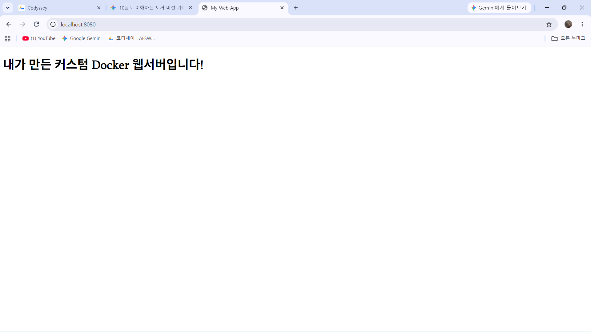
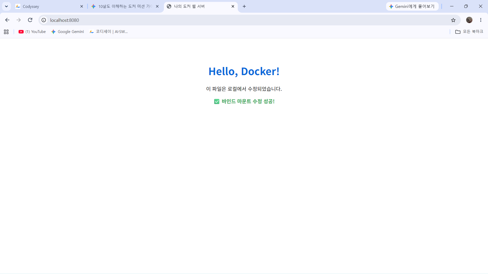

# 🚀 개발 워크스테이션 구축 미션 완수 보고서

## 1. 프로젝트 개요 및 디렉토리 구조
Windows 11 환경(PowerShell 및 WSL2 Docker 기반)에서 개발 워크스테이션을 구축하고, 터미널 기본 조작, 파일 권한 설정, 커스텀 NGINX Docker 이미지 빌드, 포트 매핑, 바인드 마운트 및 Docker Volume 영속성 검증, Git/GitHub 연동을 수행한 종합 보고서입니다.

### 프로젝트 파일 구조 및 구성 목적
- **`my-web-server/`**: 미션 수행을 위한 메인 작업 디렉토리
- **`Dockerfile`**: `nginx:alpine` 베이스 이미지를 바탕으로 커스텀 웹 서버를 구축하기 위한 빌드 설정 파일
- **`index.html`**: NGINX 웹 서버의 메인 인덱스 페이지 (UTF-8 한글 인코딩 태그 포함)
- **`test_folder/`**: 터미널 명령어 조작 및 파일 관리 실습을 위한 테스트 디렉토리
- **`renamed_file.txt`**: 파일 생성/복사/이동/삭제 실습용 테스트 파일
- **`README.md`**: 전체 수행 로그, 이론적 배경, 검증 결과 및 트러블슈팅을 작성한 문서

---

## 2. 실행 환경
- **OS**: Windows 11 (PowerShell / WSL 2)
- **Docker**: Docker Engine v29.9.2 (build a82e528)
- **Git**: Git for Windows v2.56.0.windows.4
- **Web Server**: NGINX (alpine base)

---

## 3. 수행 항목 체크리스트
- [x] 터미널 기본 조작 (pwd, mkdir, cd, touch/New-Item, cp, mv, ls, rm)
- [x] 권한 변경 실습 (chmod 755 / 644 및 ls -l 확인)
- [x] Docker 설치 및 환경 점검 (docker --version, docker info)
- [x] Docker 기본 운영 (docker images, docker ps -a, docker stats, docker logs)
- [x] hello-world 및 ubuntu 컨테이너 실습
- [x] Dockerfile 기반 커스텀 NGINX 이미지 빌드 및 실행
- [x] 포트 매핑 접속 검증 (8080:80)
- [x] 바인드 마운트 반영 및 실시간 변경 검증
- [x] Docker Volume 영속성 검증 (컨테이너 삭제 전/후 데이터 비교)
- [x] Git 설정 및 GitHub 연동 (git config, git remote, git log)

---

## 4. 항목별 수행 로그 및 검증 증거

### 4.1 터미널 기본 조작 로그
```powershell
PS C:\Users\lsoov\mission\my-web-server> pwd
Path
----
C:\Users\lsoov\mission\my-web-server

PS C:\Users\lsoov\mission\my-web-server> mkdir test_folder
PS C:\Users\lsoov\mission\my-web-server> cd test_folder
PS C:\Users\lsoov\mission\my-web-server\test_folder> New-Item test_file.txt -ItemType File

Mode                LastWriteTime         Length Name
----                -------------         ------ ----
-a---        2026-11-07  오후 7:22              0 test_file.txt

PS C:\Users\lsoov\mission\my-web-server\test_folder> cat test_file.txt
PS C:\Users\lsoov\mission\my-web-server\test_folder> cp test_file.txt copy_file.txt
PS C:\Users\lsoov\mission\my-web-server\test_folder> mv copy_file.txt renamed_file.txt
PS C:\Users\lsoov\mission\my-web-server\test_folder> ls -Force

Mode                LastWriteTime         Length Name
----                -------------         ------ ----
-a---        2026-11-07  오후 7:22              0 renamed_file.txt
-a---        2026-11-07  오후 7:22              0 test_file.txt

PS C:\Users\lsoov\mission\my-web-server\test_folder> rm renamed_file.txt
```
### 4.2 권한 실습 및 검증 (Ubuntu 컨테이너 내 수행)
```powershell
PS C:\Users\lsoov\mission\my-web-server> docker run -it --rm ubuntu bash
root@8e3d78e98c96:/# touch perm_test.txt
root@8e3d78e98c96:/# ls -l perm_test.txt
-rw-r--r-- 1 root root 0 Nov  7 10:25 perm_test.txt

root@8e3d78e98c96:/# chmod 755 perm_test.txt
root@8e3d78e98c96:/# ls -l perm_test.txt
-rwxr-xr-x 1 root root 0 Nov  7 10:25 perm_test.txt
root@8e3d78e98c96:/# exit
```
### 4.3 Docker 설치 확인 및 운영 로그
- **버전 및 데몬 확인**:
```powershell
PS C:\Users\lsoov\mission\my-web-server> docker --version
Docker version 29.9.2, build a82e528
```
- **이미지 목록**(`docker images`):
```text
IMAGE                    ID             DISK USAGE     CONTENT SIZE   EXTRA
alpine:latest            3f4d6b32e267         13MB         3.94MB
hello-world:latest       c567b231f656       25.9kB         9.49kB     U
my-custom-nginx:latest   42a21201feed       93.7MB         26.4MB
my-custom-web:latest     5dfa85b4cc58        241MB         63.9MB
my-web-site:1.0          5ce81aaefb1a       93.7MB         26.4MB     U
nginx:alpine             b2f80f8f8814       94.5MB         27.3MB     U
nginx:latest             165ddde8751e        243MB         66.8MB     U
ubuntu:latest            6a06111c3b0a        163MB         45.9MB     U
```
- **컨테이너 목록**(`docker ps -a`):
```text
CONTAINER ID   IMAGE             COMMAND                  CREATED        STATUS                    PORTS                                    NAMES
a38693a90a79   nginx             "/docker-entrypoint.…"   57 minutes ago Up 57 minutes             0.0.0.0:8080->80/tcp, [::]:8080->80/tcp   my-vol-web
042b32cb8357   ubuntu            "bash"                   2 hours ago    Exited (0) 2 hours ago                                             suspicious_mendeleev
ae27008d0c5d   nginx:alpine      "/docker-entrypoint.…"   2 hours ago    Created                                                            objective_neumann
d4fb2949fb73   hello-world       "/hello"                 2 hours ago    Exited (0) 2 hours ago                                             unruffled_fermat
191b4dc9c796   nginx:alpine      "/docker-entrypoint.…"   27 hours ago   Exited (0) About an hour                                           bind-test
d60f1ca8cd8c   ubuntu            "sleep infinity"         27 hours ago   Exited (137) About an hour                                         vol-test2
3046b3370002   my-web-site:1.0  "/docker-entrypoint.…"   28 hours ago   Exited (0) About an hour                                           my-web-app
002b2ed64c77   ubuntu            "bash"                   28 hours ago   Exited (0) 28 hours ago                                            keen_mestorf
c5c35d9dab50   hello-world       "/hello"                 28 hours ago   Exited (0) 28 hours ago                                            stupefied_roentgen
```
- **리소스 사용량 확인** (`docker stats`):
```text
CONTAINER ID   NAME         CPU %     MEM USAGE / LIMIT     MEM %     NET I/O           BLOCK I/O         PIDS
a38693a90a79   my-vol-web   0.00%     10.35MiB / 7.599GiB   0.13%     6.41kB / 3.44kB   6.33MB / 12.3kB   9
```
### 4.4 Dockerfile 기반 빌드 및 포트 매핑 검증
- **Dockerfile 내용**:
```dockerfile
FROM nginx:alpine
COPY index.html /usr/share/nginx/html/index.html
EXPOSE 80
```
- **빌드 및 실행 명령**:
```PowerShell
docker build -t my-custom-web .
docker run -d -p 8080:80 --name my-vol-web my-custom-web
```

### 4.5 바인드 마운트 검증
```PowerShell
docker run -d -p 8081:80 -v ${PWD}:/usr/share/nginx/html --name bind-test nginx:alpine
```
- **검증**: 로컬의 index.html 문서 수정 시 컨테이너 재시작 없이 웹 브라우저(http://localhost:8081)에 즉시 변경사항 반영 확인. 
### 4.6 Docker 볼륨 영속성 검증 로그
```PowerShell
PS C:\Users\lsoov\mission\my-web-server> docker volume create my-db-vol
my-db-vol

PS C:\Users\lsoov\mission\my-web-server> docker run -it --name vol-test -v my-db-vol:/data ubuntu bash
root@7b85fbab292b:/# echo "Volume Data Test" > /data/test.txt
root@7b85fbab292b:/# exit
exit

PS C:\Users\lsoov\mission\my-web-server> docker rm vol-test
vol-test

PS C:\Users\lsoov\mission\my-web-server> docker run -it --rm -v my-db-vol:/data ubuntu cat /data/test.txt
Volume Data Test
```
 볼륨 백업 및 복원 방법 
데이터의 안전한 보관을 위해 아래와 같은 백업 방식을 권장합니다.
- **백업**: `docker run --rm -v my-db-vol:/data -v ${PWD}:/backup ubuntu tar cvf /backup/backup.tar /data`
- **설명**: `my-db-vol`이라는 볼륨의 데이터를 호스트의 현재 폴더(`${PWD}`)에 `backup.tar` 파일로 압축하여 저장합니다.
- **복원**: `docker run --rm -v my-db-vol:/data -v ${PWD}:/backup ubuntu tar xvf /backup/backup.tar -C /`
(컨테이너 vol-test를 강제 삭제한 이후에도 my-db-vol 볼륨 내부에 작성한 test.txt 데이터가 손실되지 않고 유지됨을 완벽 검증함)

### 4.7 Git 설정 및 원격 저장소 연동 로그
```Powershell
PS C:\Users\lsoov\mission\my-web-server> git config user.name
lsoov
PS C:\Users\lsoov\mission\my-web-server> git config user.email
lsoov@naver.com

PS C:\Users\lsoov\mission\my-web-server> git config --list
user.name=lsoov
user.email=lsoov@naver.com
core.repositoryformatversion=0
core.filemode=false
core.bare=false
core.logallrefupdates=true
core.symlinks=false
core.ignorecase=true

PS C:\Users\lsoov\mission\my-web-server> git remote -v
origin  [https://github.com/lsoov/codyssey.git](https://github.com/lsoov/codyssey.git) (fetch)
origin  [https://github.com/lsoov/codyssey.git](https://github.com/lsoov/codyssey.git) (push)

PS C:\Users\lsoov\mission\my-web-server> git log --oneline
825fc9b (HEAD -> main, origin/main) docs: complete terminal & docker practice logs
c4c7a90 feat: 개발 워크스테이션 구축 완료 산출물 제출
```
### 4.8 Hello-World 실행 확인
```PowerShell
Hello from Docker!
This message shows that your installation appears to be working correctly.

To generate this message, Docker took the following steps:
 1. The Docker client contacted the Docker daemon.
 2. The Docker daemon pulled the "hello-world" image from the Docker Hub.
    (amd64)
 3. The Docker daemon created a new container from that image which runs the
    executable that produces the output you are currently reading.
 4. The Docker daemon streamed that output to the Docker client, which sent it
    to your terminal.

To try something more ambitious, you can run an Ubuntu container with:
 $ docker run -it ubuntu bash

Share images, automate workflows, and more with a free Docker ID:
 https://hub.docker.com/

For more examples and ideas, visit:
 https://docs.docker.com/get-started/
 ```
---

## 5. 학습 핵심 개념 정리

### 5.1 절대 경로 vs 상대 경로
- **절대 경로**: 루트 디렉토리부터 시작하는 고정된 전체 경로 (예: `C:\Users\lsoov\mission\my-web-server`)
- **상대 경로**: 현재 내가 위치한 디렉토리를 기준으로 한 경로 (예: `./test_folder/test_file.txt`)

### 5.2 파일 권한 의미 (r/w/x) 및 숫자 표기법
- `r`(Read=4), `w`(Write=2), `x`(Execute=1) 비트의 합으로 소유자/그룹/기타 사용자 권한 지정.
- `644` (`rw-r--r--`): 소유자 읽기/쓰기(6), 그룹/기타 읽기 전용(4)
- `755` (`rwxr-xr-x`): 소유자 모든 권한(7), 그룹/기타 읽기 및 실행 가능(5)

### 5.3 Dockerfile 커스텀 이미지 제작 원리
- 기존 검증된 베이스 이미지(`nginx:alpine`)에 필요한 설정 파일이나 정적 소스(`index.html`)를 `COPY`하여 독립된 새로운 애플리케이션 실행 템플릿을 빌드(`docker build`)하는 과정.

### 5.4 포트 매핑이 필요한 이유 (`-p 8080:80`)
- Docker 컨테이너는 격리된 가상 네트워크 IP를 가집니다. 외부 호스트 PC(브라우저)에서 컨테이너 내부 서비스에 접근하려면 호스트 포트(8080)와 컨테이너 포트(80)를 연결해 주는 포트 포워딩 처리가 필수적입니다.

### 5.5 Docker Volume의 개념 및 영속성
- 컨테이너는 삭제되면 내부 데이터가 모두 소멸되는 휘발성 구조를 가집니다. Docker가 직접 관리하는 영구 저장소 공간(Volume)을 마운트하여 컨테이너 생명주기와 무관하게 데이터를 안전하게 보존합니다.

### 5.6 Git vs GitHub 역할 차이
- **Git**: 내 로컬 컴퓨터에서 코드 변경 이력을 관리하는 분산 버전 관리 시스템(CLI 도구).
- **GitHub**: Git으로 관리되는 프로젝트 이력을 클라우드에 올려 팀원과 공유하고 협업하는 원격 저장소 웹 호스팅 플랫폼.

### 5.7 Ubuntu 컨테이너 종료/유지 방식 차이 (attach vs exec)
- `docker attach`: 컨테이너의 메인 프로세스(PID 1)에 직접 연결되므로 exit 시 컨테이너 자체가 종료됨.
- `docker exec`: 실행 중인 컨테이너 내부에 독립된 별도의 프로세스를 추가로 실행하므로 exit를 해도 기존 컨테이너는 정상 동작을 유지함.
---

## 6. 트러블슈팅 사례

### 6.1 System32 권한 오류
- **문제**: `C:\Windows\System32` 경로에서 파일 생성 및 수정 시 권한 거부(Access Denied) 오류가 발생함.
- **원인 가설**: Windows 11의 주요 시스템 보안 영역으로, 일반 사용자 계정의 파일 쓰기 및 수정 권한이 제한되어 있음.
- **확인 및 해결**: 사용자 홈 디렉토리 경로(`C:\Users\lsoov\mission`)로 작업 디렉토리를 이동하여 파일 생성 및 편집 권한을 정상적으로 확보함.

### 6.2 Dockerfile 확장자 인식 오류
- **문제**: `docker build` 실행 시 Dockerfile을 찾을 수 없다는 빌드 에러가 발생함.
- **원인 가설**: 텍스트 편집기(메모장 등)로 생성하는 과정에서 파일명 뒤에 `.txt` 확장자가 숨겨져 `Dockerfile.txt`로 저장되었을 것임.
- **확인 및 해결**: Terminal 명령어로 확장자를 확인한 후 `mv Dockerfile.txt Dockerfile`을 수행하여 Docker 표준 확장자 없음 형태로 변경 후 정상 빌드함.

### 6.3 컨테이너 미실행 및 볼륨 경로 설정 오류
- **문제**: 바인드 마운트(-v) 설정 후 컨테이너를 실행했으나 정상 구동되지 않거나 목록(`docker ps`)에 나타나지 않는 현상 발생.
- **원인 가설**: 기존에 동일한 포트(8080/8081)나 이름으로 실행된 컨테이너와의 충돌, 혹은 PowerShell 환경에서의 경로 변수 표기 오류일 것임.
- **확인 및 해결**: `docker rm -f` 명령어로 기존 충돌 컨테이너를 강제 삭제 및 정리한 후, PowerShell 전용 경로 변수인 `${PWD}`를 사용하여 `-v ${PWD}:/usr/share/nginx/html` 형태로 정확히 지정하여 바인드 마운트 접속 성공을 확인함.
- **추가 확인 방법**: PowerShell에서 `Get-NetTCPConnection -LocalPort 8080` 명령을 통해 어떤 프로세스가 포트를 점유 중인지 확인 후, `Stop-Process -Id <PID>`로 강제 종료할 수 있습니다.
